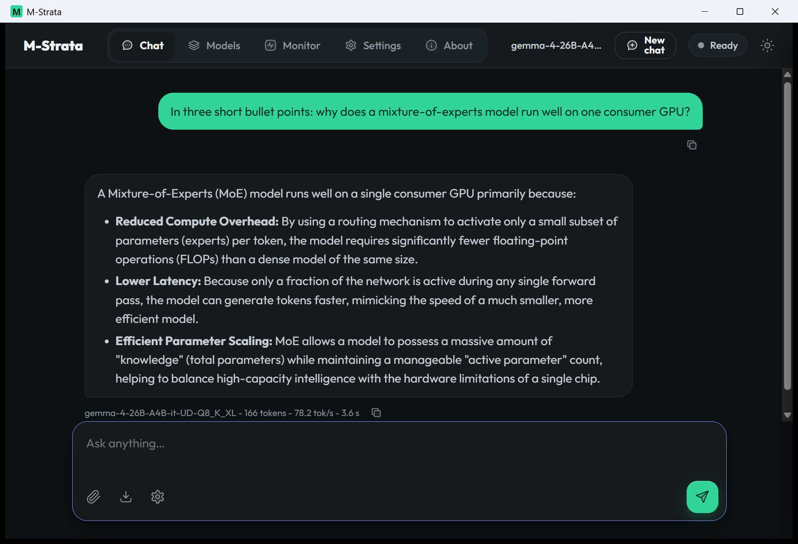
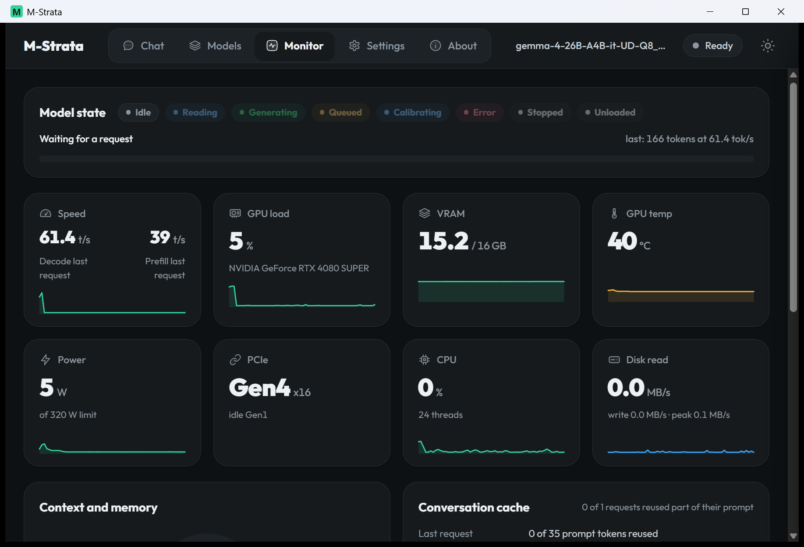
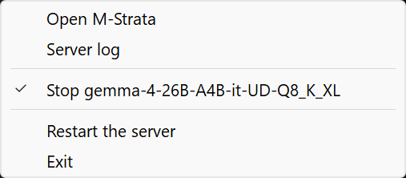
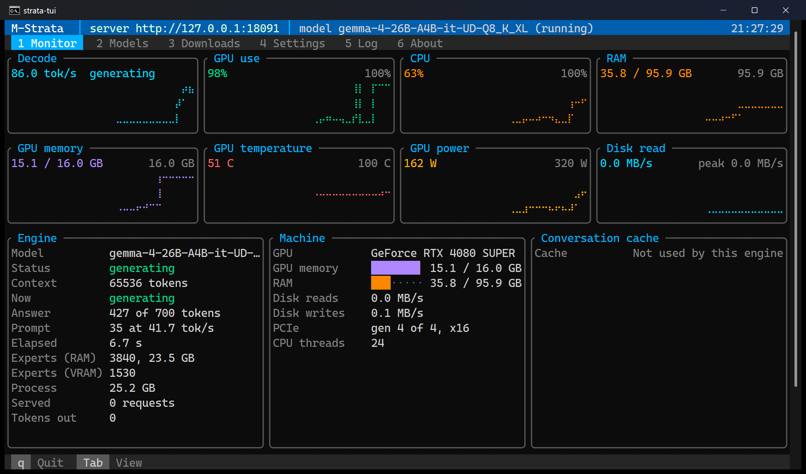
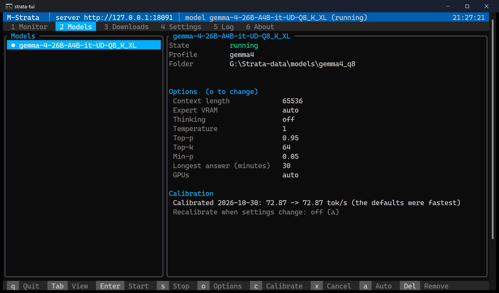

# M-Strata (Multiengine Strata)

**M-Strata** - Multiengine Strata - is our own inference engine for large mixture-of-experts (MoE) language models on a single consumer GPU, plus a
security-first server in front of it. The engine keeps a model's hot experts in VRAM and the rest in pinned RAM
(read from disk when RAM runs out), and computes some of them on the CPU while the GPU works: the expert tiering
described by Strata (Niko1221). It is built from Strata's and Project Maya's sources with llama.cpp/ggml's quantized
kernels, extended for the model families below. Nothing here is released yet.

The project's live status is [`docs/AGENT_HANDOFF.md`](docs/AGENT_HANDOFF.md) (newest change first); this page
summarizes it as of 2026-10-28. All GPU numbers are from the development system below, except the
[Compatibility](#compatibility) rows of a second PC.

- [Features](#features)
- [What is in the repository](#what-is-in-the-repository)
- [Models](#models)
- [Development system](#development-system)
- [Compatibility](#compatibility)
- [What this system could not test](#what-this-system-could-not-test)
- [Install](#install)
- [Configure](#configure)
- [Use](#use)
- [Troubleshooting](#troubleshooting)
- [Current progress and open items](#current-progress-and-open-items)
- [License](#license)
- [Sources and credits](#sources-and-credits)

## Features

**The engine**

- **One engine for many model families:** `multiengine` loads one library per family (Qwen3.8, Qwen3.6, GLM-5.3,
  DeepSeek-V4.1, MiniMax-M3.1, Raon-1-mini, Gemma 4, flint); the server starts the right one for the model you pick.
- **Expert tiering for MoE models larger than VRAM:** the hot experts stay in a VRAM cache, the rest in pinned RAM
  (read from disk when RAM runs out), and some are computed on the CPU while the GPU works, as Strata describes.
- Batched prompt processing, speculative decoding (the model's MTP draft layer and prompt lookup on Qwen; Gemma 4's MTP
  draft model, which decodes about 1.2x faster here with the same output), several KV
  cache formats, KV streaming for long contexts, and contexts up to 1M tokens where the model allows it.
- **`strata-prepare`** builds the packs Qwen3.8, GLM-5.3, DeepSeek-V4.1, MiniMax-M3.1 and Raon-1-mini need, natively
  (no Python), with the same bytes as upstream's and Project Maya's tools.
- **Pictures** on Qwen3.8 and Qwen3.6: upstream's picture encoder, `strata-vision` (llama.cpp's mtmd), runs beside the
  engine and turns each picture into the embeddings the engine reads, on the GPU (about 1 GB of VRAM) or the CPU.
- **Several GPUs**, as upstream and Project Maya run them: Qwen splits its layers across the GPUs you pick, GLM-5.3 and
  Raon-1-mini split theirs (the GLM engine's split), DeepSeek-V4.1 runs tensor-parallel pairs, MiniMax-M3.1 takes the
  list; Gemma 4 and flint run on one GPU.

**Model selection and engine swap**

- **Model cards:** every model you add or download becomes a card on the page's **Models** tab, with the options its
  engine takes: context length, KV cache format, thinking level, temperature, top-p and the other sampling defaults,
  web search, and the **longest answer** (minutes; 30 by default, the server's own setting). The page remembers each
  card's last options; **Defaults** resets them.
- **Start, Stop and swap:** Start runs the card you pick; starting another card swaps the engine. The new model and its
  tokenizer are checked before the running one is touched, the answer in progress may finish (up to 60 s), then the old
  engine stops and the new one loads; a start that fails never takes the running model down. One model runs at a
  time, and Stop gives its GPU and RAM back.
- **GPUs:** on a PC with several GPUs, each card has a box per GPU (as nvidia-smi numbers them); none ticked is the
  first GPU. About lists this PC's GPUs.
- **Calibrate** tunes the settings that depend on this PC by timing real engine starts, once per card, on every model,
  each with its reference tool's steps:
  - Qwen: upstream Strata's `tools/calibrate.py` (the PCIe share, the draft floor, the CPU pool workers, the adaptive
    expert tier);
  - GLM-5.3 and raon1: Project Maya's `calibrate_glm.py` (the PCIe share and the CPU lane's threads);
  - DeepSeek-V4.1 and MiniMax-M3.1: Maya's CPU-thread step;
  - flint and Gemma 4: their engines' CPU lane, PCIe share and threads.

  **Start** on a card never calibrated on this PC asks first: **Calibrate, then start** (recommended), **Start without
  calibrating**, or **Cancel**. A calibration shows its progress and a **Cancel** button (the TUI: `x`); a cancelled
  calibration keeps nothing, and one you asked for before a start offers that start without it. Each candidate is a
  start of the model: flint and Gemma 4 take a few short starts, the large models (as upstream and Maya do) can take an
  hour or more. **Calibrate** also runs one on its own.
  MiniMax also measures how this PC reads prompts once, before its first start, as Maya does (a few minutes).
- **A report for a bug report** when a calibration has an error: a trial whose engine does not start, ends before it is
  ready or fails an answer. The report is Markdown, ready to paste into an issue, and lists:
  - what failed, and every trial with its setting and speed;
  - for each failed trial, the server's lines for its engine (how it ended, with its exit code) and the engine's own
    last 40 lines;
  - this PC's hardware: the CPU and its cores, the RAM and how much was free, each GPU with its driver, compute
    capability, PCIe link and power limit, and the operating system;
  - the engine folder's build.

  It is saved in the logs folder (`data/logs/calibration-reports/`). The card offers **Show the report** (read, Copy,
  Save) and the TUI says where it is. Paths in the model, data, engine and home folders are shortened; it holds no key,
  user name or host name. Look it over before you share it.
- **Models > Compatibility:** the [compatibility table](#compatibility) for your PC, built from the models calibrated
  on this server: a **Pass** row per finished calibration (its speed), a **Fail** row per failed one (its reason and
  report), this PC's OS, CPU, GPU, VRAM and RAM, and your own notes (kept for the browser tab). **Copy** and **Save**
  give the Markdown the README's table takes, to paste into an issue on this project's GitHub page. (The page links to
  no other site, so it does not open GitHub itself.)
- **Add a model** from files already on this PC (a folder and its `.gguf`); the pack is built when the family needs one.
  A Qwen model whose folder holds its picture encoder (one `mmproj*.gguf`) gets a card that reads pictures, with a
  **Pictures** option (GPU, CPU or off).
  Each card shows its folder (move the files and point the card there); **Remove card** takes a card off the list and
  keeps its model files (a running model is stopped first); the **danger zone** deletes a model's files, card and
  calibration after three confirmations.

**Download manager**

- **A built-in catalog** of the models this project runs (Qwen3.8-Flash-Next with its Coder, Gyro, Swift and Unsloth
  quants, Qwen3.6, GLM-5.3, DeepSeek-V4.1 and MiniMax-M3.1 in Project Maya's packs), every file pinned by its SHA-256,
  or **any Hugging Face link** to a `.gguf` (a split model's whole set), shown for confirmation first.
- Into a **drive or folder you choose**, its free space shown and checked first (plus a 2 GiB margin), or a new private
  folder. The **Download to** panel at the top of the list shows the drive, the folder and a gauge of the drive's space,
  with **Change...**, and warns when the largest download waiting there does not fit.
- **What you already have:** a catalog model that is on this PC says so instead of offering a download - **Downloaded**
  (it came from this download) or **Locally provided** (the same model file added from a folder, matched by its first
  file's name and, where the catalog pins it, its size), with its card's name. A file of that name with another size (a
  different revision of it) shows **Other version on this PC** and its card, and keeps its Download (the catalog's
  version). A download whose files are installed but whose card was never made offers **Set up**, which makes the card
  (nothing is downloaded again).
- The catalog is grouped by model family, each group a section that opens on a click and sums up what it holds; a
  group with a download under way, paused or failed opens by itself.
- **16 connections at once** for a large file (`pull.connections`, 1-32), a progress line with speed and time left,
  **Pause** and **Resume** (it continues from the pieces already fetched), **Cancel** (deletes the partial files), and a
  queue: one download runs, the next starts when it ends.
- **Vision files:** a Qwen entry's checkbox also fetches its picture encoder (about 0.9 GB, pinned like the model);
  its card then reads pictures.
- When the files are verified, the model is packed if it needs it and appears as a card, ready to start.
- The transfer is a separate confined process (`strata pull`): HTTPS to Hugging Face only; the server itself has no
  network code.

**Notifications**

- On the page: a notice when a download is queued, paused, cancelled, finished, failed or ready, and when a model is
  running, stopped or did not start.
- **Email alerts** (a build with `email`): over SSL/TLS or STARTTLS, for downloads finished or failed, calibrations
  finished or failed, the engine stopped unexpectedly, and the server started. "Fill in IONOS" presets one provider,
  "Send a test email" checks it, and the password is stored apart and never shown again (DPAPI on Windows).

**Web search through MCP and SearXNG**

- A build with `search` has `strata-search`, an MCP server the server runs as a private child, which asks **your own
  SearXNG instance**. Qwen3.6, Qwen3.8, GLM-5.3, Raon-1-mini, flint, Gemma 4, DeepSeek-V4.1 and MiniMax-M3.1 models get a `web_search` tool, each in its own
  template's form, and decide when to search.
- Up to `search.max_rounds` searches per answer (8 by default), then the model answers from what it found; the chat
  shows each search and its results in a box, and the API returns them as `strata_search` events.
- On or off per card, per chat (the chat settings' switch) and per request (`"strata_search": false`); a test search
  in the Settings tab shows what a model reads; a search that found nothing says why.

**The page and the API**

- **Chat** with Markdown, the model's reasoning in its own block, text-file and picture attachments (PNG, JPEG, WebP,
  while the running card reads pictures), saving a chat as Markdown, and
  the sampling drawer (thinking, temperature, top-p, max tokens, seed): it starts at the running card's thinking
  level, temperature and top-p, and every start of a model sets it back to that card's (Reset does too). **Monitor:** GPU load, VRAM, temperature, power,
  PCIe, CPU, disk reads and RAM, decode and prefill speed, the context fill, the experts in each tier with the engine's
  own memory, the conversation cache, and the recent requests (never their text); its live figures clear when no model
  runs. **About:** the engines this folder was built with and this PC's hardware. Light and dark; fits a phone.
- **OpenAI-compatible API:** `/v1/chat/completions` (streamed or not, with usage and `reasoning_effort`),
  `/v1/models`, `/health` and `/metrics`.
- **Settings tab:** the API key (show, copy, rotate), where the server listens and which PCs may use it, limits and
  timeouts, the download folders, and the model folders (as they are, or on network shares - experimental), email
  alerts, web search, and - in a debugging build - **Troubleshooting** (the engine's own output in the server log).
- **Model folders on network shares - experimental, off by default:** a model folder may be on an SMB/CIFS share
  or an NFS mount once Settings turns it on; see
  [Model folders on network shares](#model-folders-on-network-shares-experimental) for what it means and its status.
- **A debugging build** (`make --debugging`, `install.bat -Debugging`): verbose logs to find out why a model does not
  start or calibrate, said before the build, at every start of the server, and in the window and terminal apps,
  which ask before they start it. Only a debugging build has Settings > Troubleshooting.
- **The install scripts ask what to build:** email alerts, web search, the window app, the terminal app, the
  GLM/DeepSeek/MiniMax engines, raon1, pictures, and a debugging build - one question each, Enter for the default.

**The window app**

- **`strata-window`** (a build with `window`) is the server in a window. It runs the server as its child, signs you
  in with the one-time link and shows the page, opening on the Monitor. Closing the window keeps the server running in the tray; the tray
  icon's menu opens the window, starts or stops a model, restarts the server and exits (the model stops in order
  first). **Server log** (the tray, or Ctrl+Shift+L) shows the server's lines live, to copy or save. Windows uses
  Microsoft Edge WebView2, part of Windows 10 and 11; Linux uses WebKitGTK and a tray icon (Ayatana AppIndicator).

**The terminal app**

- **`strata-tui`** (a build with `tui`) is the server in a terminal, for a PC with no desktop (a server over SSH) or
  anyone who prefers one. It runs the server as its child, as the window does, and opens on a **Monitor dashboard**:
  braille charts of decode speed, GPU use, CPU, GPU memory, temperature and power, with the engine, the machine and the
  last requests beside them. Its other views have the page's controls: **Models** (start, stop, each card's options,
  calibrate), **Downloads**, **Settings** (edit and save; the API key shown only when you ask, and its rotation),
  **Log** and **About**. Keys: `1`-`6` or Tab for the views, the arrows, Enter, and `q` to quit (it asks, then stops
  the model and the server in order).

**Security**

- An API key on every route, shown once through a one-time login link; the Settings tab or `strata key show` and
  `key rotate`.
- Loopback by default: serving the LAN, wildcard binds and model control from other PCs are separate opt-ins (control
  can be limited to the hosts and subnets you list), with Host and Origin checks and a strict page policy.
- The engine runs as a private child with no shell and a fixed environment. The server tokenizes every prompt itself
  and refuses user text that spells a model's control tokens. Model folders are made private (or used as they are, if
  you choose).

## What is in the repository

| Part | What it is |
| --- | --- |
| [`engine/`](engine/) | **The engine.** `multiengine.exe` is a launcher over one library per model family: `multiengine_strata.dll` (upstream Strata's engine, `v0.2.6`: Qwen3.8 and Qwen3.6), `multiengine_maya.dll`, `multiengine_maya_ds4.dll` and `multiengine_maya_mm3.dll` (Project Maya `v1.1.30`: GLM-5.3, DeepSeek-V4.1, MiniMax-M3.1), `multiengine_raon1.dll`, `multiengine_gemma4.dll` and `multiengine_flint.dll`. `strata-prepare.exe` builds the packs some families need. Shared parts: the expert tiers (VRAM slot cache, pinned RAM tier, CPU expert lane, disk reads), the batched prompt path, speculative decoding (MTP), CUDA kernels and llama.cpp's MMQ. Build notes: [`engine/README.md`](engine/README.md). |
| [`secure_frontend/`](secure_frontend/) | **The server.** A dependency-free C++20 program (`strata-unified-server`) that owns the listener and runs the engine as a private child over standard I/O: an API key on every listener (loopback by default; remote and wildcard binds are separate opt-ins), Host/Origin checks, an OpenAI-compatible `/v1/chat/completions` with streaming, `/v1/models`, health and metrics, a built-in web page (chat, monitor, models), model cards the page adds, starts, stops and calibrates, Hugging Face downloads, optional email alerts and optional web search for the model. It tokenizes prompts itself and refuses user text that spells a model's control tokens. The reference for every setting is [`secure_frontend/README.md`](secure_frontend/README.md). |
| [`make.py`](make.py), `make.bat`, `make.sh` | Build everything into one folder that holds only what runs. |
| [`engines/gemma4/`](engines/gemma4/), [`engines/unified/`](engines/unified/) | Earlier standalone engines whose pieces now live in `engine/`. |
| `serve/`, `strata_cli/`, `strata_control/` | Strata's Python serve layer, kept for reference and older scripts; `secure_frontend` replaces it. |
| [`upstream/`](upstream/) | Upstream Strata as an unmodified git submodule, the reference we track. |
| [`engines/maya-ref/`](engines/maya-ref/) | Project Maya as a read-only reference submodule; never built. |

## Models

| Model | Engine library | Status |
| --- | --- | --- |
| **Qwen3.8-Flash-Next** (IQ3_S and other quants) | `multiengine_strata.dll` | **Works** from a page card (its pack built by `strata-prepare`): about 45 tok/s. **Pictures work** with its picture encoder on the GPU: a test picture answered correctly in about 4 s. |
| **Qwen3.6-35B-A3B** (Q8_0) | `multiengine_strata.dll` | **Works** from a page card made straight from the GGUF: about 29 tok/s; web search checked end to end. |
| **GLM-5.3-Flash** (Maya packs) | `multiengine_maya.dll` | **Runs** from a page card (Maya's pack built beside the shards); speed not tuned yet. |
| **Raon-1-mini** (KRAFTON, Q8_0) | `multiengine_raon1.dll` | **Works, verified** against KRAFTON's llama.cpp (mean KL 0.0009, top-1 100% on short prompts); 74 tok/s short, 52 tok/s at 9K context; 256K context. |
| **Gemma 4 26B-A4B** (UD-Q8_K_XL) | `multiengine_gemma4.dll` | **Works:** KL 0.040 against llama.cpp, 47-60 tok/s. |
| **flint** (RecursiveSI, Q8_0) | `multiengine_flint.dll` | **Works:** about 49-53 tok/s decode, checked against llama.cpp's flint. |
| DeepSeek-V4.1-Flash | `multiengine_maya_ds4.dll` | **Runs** from a page card (Maya-XS): 11.6 tok/s, Maya's own engine 11.3 (2026-10-29). |
| MiniMax-M3.1-Flash (Maya-XS, Maya-S) | `multiengine_maya_mm3.dll` | **Runs** from a page card (Maya-S): 3.9 tok/s, Maya's own engine 4.0 (2026-10-29; MiniMax Community License, see below). |

## Development system

Everything above was built and measured on one Windows desktop:

| Part | Specification |
| --- | --- |
| CPU | AMD Ryzen 9 3900X, 12 cores / 24 threads |
| Memory | 96 GB DDR4-3600 (2 x 32 GB + 2 x 16 GB) |
| GPU | NVIDIA GeForce RTX 4080 SUPER, 16 GB GDDR6X, PCIe 4.0 x16, 320 W power limit (compute capability 8.9) |
| Motherboard | MSI PRO B550M-VC WIFI |
| Storage | 5 SSDs: 2 x 1 TB NVMe, 512 GB NVMe, 250 GB SATA, 128 GB SATA (models spread over several drives) |
| Operating system | Windows 11 Pro 64-bit (build 26200) |
| Toolchain | Visual Studio 2022 Build Tools (MSVC), CUDA Toolkit 13.0, NVIDIA driver 610.88, CMake and Ninja (pip), Python 3.12 |

A model larger than VRAM keeps its experts in RAM (and reads the rest from disk): with 96 GB, a Qwen3.8 IQ3_S
(about 84 GB) or a GLM-5.3-Flash Maya-S pack (about 96 GB) runs with most experts in RAM. Smaller systems work, more
slowly, when the drive is fast NVMe.

## Compatibility

What has been run, on which PC (status 2026-10-30). Each row is one PC and one model family: **Pass** when it
loads, answers and its checks hold, **Fail** when it does not. Three machines so far: the development system above, a
second Windows desktop with an RTX 5090 (Blackwell) and 48 GB of RAM, which has run the two Qwen families, and an
Azure `Standard_NC4as_T4_v3` virtual machine (Ubuntu 22.04, a Tesla T4), where `install.sh` built and installed
everything on Linux for the first time; no model has run there yet (see
[What this system could not test](#what-this-system-could-not-test)).
Results from other PCs are welcome: the page's **Models > Compatibility** tab builds these rows for your PC from the
models you calibrated, with your notes, ready to copy into a GitHub issue; a calibration with an error also writes a
report with the details.

| OS | CPU | GPU Type | VRAM | RAM | Model Family | Pass | Fail | Notes |
| --- | --- | --- | --- | --- | --- | --- | --- | --- |
| Windows 11 Pro (build 26200) | AMD Ryzen 9 3900X, 12 cores / 24 threads | NVIDIA RTX 4080 SUPER (Ada, 8.9) | 16 GB | 96 GB | Qwen3.8-Flash-Next (IQ3_S) | ✅ | | 94 tok/s with its MTP draft layer (upstream's own engine: 89), 59 without it. Pictures work (encoder on the GPU). |
| Windows 11 Pro (build 26200) | AMD Ryzen 9 3900X, 12 cores / 24 threads | NVIDIA RTX 4080 SUPER (Ada, 8.9) | 16 GB | 96 GB | Qwen3.6-35B-A3B (Q8_0) | ✅ | | About 29 tok/s. Web search checked end to end; pictures not tried yet. |
| Windows 11 Pro (build 26200) | AMD Ryzen 9 3900X, 12 cores / 24 threads | NVIDIA RTX 4080 SUPER (Ada, 8.9) | 16 GB | 96 GB | GLM-5.3-Flash (Maya-S v2) | ✅ | | 9.8 tok/s with the card's RAM headroom at 6 GB (Maya's own engine: 9.7); 3.9 at the default 16 GB. |
| Windows 11 Pro (build 26200) | AMD Ryzen 9 3900X, 12 cores / 24 threads | NVIDIA RTX 4080 SUPER (Ada, 8.9) | 16 GB | 96 GB | DeepSeek-V4.1-Flash (Maya-XS) | ✅ | | 11.6 tok/s (Maya's own engine: 11.3). With 96 GB of RAM most experts are read from disk. |
| Windows 11 Pro (build 26200) | AMD Ryzen 9 3900X, 12 cores / 24 threads | NVIDIA RTX 4080 SUPER (Ada, 8.9) | 16 GB | 96 GB | MiniMax-M3.1-Flash (Maya-S) | ✅ | | 3.9 tok/s (Maya's own engine: 4.0). |
| Windows 11 Pro (build 26200) | AMD Ryzen 9 3900X, 12 cores / 24 threads | NVIDIA RTX 4080 SUPER (Ada, 8.9) | 16 GB | 96 GB | Raon-1-mini (Q8_0) | ✅ | | Verified against KRAFTON's llama.cpp (mean KL 0.0009); 74 tok/s short, 52 tok/s at 9K context. |
| Windows 11 Pro (build 26200) | AMD Ryzen 9 3900X, 12 cores / 24 threads | NVIDIA RTX 4080 SUPER (Ada, 8.9) | 16 GB | 96 GB | Gemma 4 26B-A4B (UD-Q8_K_XL) | ✅ | | 73-78 tok/s after calibration (2026-10-29); KL 0.040 against llama.cpp. |
| Windows 11 Pro (build 26200) | AMD Ryzen 9 3900X, 12 cores / 24 threads | NVIDIA RTX 4080 SUPER (Ada, 8.9) | 16 GB | 96 GB | flint (Q8_0) | ✅ | | 49-53 tok/s; checked against llama.cpp's flint. |
| Windows 11 Pro (build 26300) | AMD Ryzen 9 9950X, 16 cores / 32 threads | NVIDIA RTX 5090 (Blackwell, 12.0) | 32 GB | 48 GB | Qwen3.8-Flash-Next (Swift IQ3_XXS) | ✅ | | 175 tok/s at calibration with its MTP draft layer; 122-168 tok/s in chats (a 45K-token answer at 132), a 7.5K-token prompt read at 2,800 tok/s. Its 40 GB expert arena is about 1 GB more than the free RAM: 27 GB of it is pinned, the rest pageable (2026-10-29). |
| Windows 11 Pro (build 26300) | AMD Ryzen 9 9950X, 16 cores / 32 threads | NVIDIA RTX 5090 (Blackwell, 12.0) | 32 GB | 48 GB | Qwen3.6-35B-A3B (Q8_0) | ✅ | | 88 tok/s at calibration; 46-65 tok/s in chats (a 10,800-token answer at 46). 68 of its 256 experts per layer in VRAM, the rest in RAM (2026-10-29). |
| Ubuntu 22.04.5 LTS (Azure `Standard_NC4as_T4_v3`) | AMD EPYC 7V12, 4 vCPUs | NVIDIA Tesla T4 (Turing, 7.5) | 16 GB | 28 GB | None yet: the build and install | ✅ | | 2026-10-30: `install.sh` with every engine family, the picture encoder, the window app and the TUI (GCC 13 from Ubuntu's toolchain PPA, CUDA 13.0, `75-real`); the server, its page and API, and web search through a local SearXNG checked. No model downloaded or run yet. |

## What this system could not test

One Windows desktop with one NVIDIA GPU cannot check everything the code supports. These parts are built and covered
by the server's tests (with fake engines where a GPU would be needed), but have **not been run on real hardware**:

| Area | What is untested, and why |
| --- | --- |
| **Several GPUs** | The GPUs choice on the cards, Qwen's layer split, GLM-5.3's and Raon-1-mini's split, DeepSeek-V4.1's tensor-parallel pairs and MiniMax-M3.1's GPU list are composed as upstream and Project Maya compose them, and checked argument by argument, but never run: the development system has one GPU. Upstream's card order for a split (the faster card last) is not done yet. |
| **Pictures (vision)** | Checked on Qwen3.8-Flash-Next IQ3_S with its encoder on the GPU (a red square and a blue circle, named and placed correctly, about 4 s). Not yet run: Qwen3.6, the encoder on the CPU, several pictures in one question, and pictures through the page's attach button (the check used the API). |
| **DeepSeek-V4.1 and MiniMax-M3.1** | Run here once each (Maya-XS and Maya-S, 2026-10-29), at Maya's own engine's speed. Their GGUFs are large (DeepSeek's 277-508 GB, MiniMax's from 93 GB): with 96 GB of RAM most of their experts come from disk, so these runs show that they work, not how fast they can be on a PC with more RAM. |
| **Other GPU makers** | Only NVIDIA CUDA builds are made and run. Upstream's AMD (HIP) and Intel (SYCL) paths are in the tree but neither built nor tested here. |
| **Other NVIDIA generations** | Every speed in the Models table is from one RTX 4080 SUPER (compute capability 8.9). Every engine compiles for Turing, Ampere, Ada, Hopper and Blackwell (`--cuda-arch compatible`, built here 2026-10-29). Blackwell has run on a second PC, an RTX 5090 (12.0) with 48 GB of RAM, but only the two Qwen families (see [Compatibility](#compatibility)). No other generation has been run, nor GPUs with less than 16 GB, or PCs with less than 48 GB of RAM. |
| **Linux** | Every change is written for Linux and Windows. Since 2026-10-28 the frontend is built and tested here on Linux too: GCC 13.3 and Clang 18.1 (CI's compilers) in a WSL 2 Ubuntu 24.04, with the whole test suite (1401 of 1402 pass with GCC on 2026-10-28, the one left only when run in parallel; tests that need a second user, real model packs or SearXNG skip). The CUDA engines and the whole install were first built on Linux on 2026-10-30, by `install.sh` on an Azure `Standard_NC4as_T4_v3` (Ubuntu 22.04, a Tesla T4); no model has run on Linux yet. |
| **The window app on Linux** | `strata-window`'s Linux window (GTK 3, WebKitGTK 4.1, Ayatana AppIndicator) was built and run in that WSL Ubuntu under WSLg, Windows 11's display for Linux apps. Checked there: the page signed in on the Monitor, closing to the tray, one window per data folder, an orderly stop, and the tray menu (start, stop, open, exit) driven over D-Bus. Not checked: a real Linux desktop, the tray icon itself (WSLg has no tray to show it in) and its notifications. |
| **The terminal app** | `strata-tui` was run here in a real Windows console and, on Linux, under tmux with GCC's build: every view, editing and saving, resizes, quitting, and a terminal hangup (the server and its model stop in order). It runs with the test suite's fake engine, not a real model, and has not been tried over a real SSH connection or in other terminal programs. |
| **The install scripts' installs** | `install.bat` was run here end to end, on a PC that already had every dependency, so its winget installs (Git, Python, Build Tools or the C++ workload, CUDA) have not run yet. `install.sh` is syntax-checked only: the development system has no Linux. |

## Install

There are two ways: **one script** that installs what is missing and builds (start here), or **the same steps by
hand**. Either way you end with an *out folder*: everything M-Strata needs to run, which you can move anywhere.

### What you need

| | Windows | Linux |
| --- | --- | --- |
| System | Windows 10 or 11, 64-bit | x86_64; the script knows Ubuntu 22.04+ and Debian 13+ (apt) |
| GPU | An NVIDIA GPU with a current driver (CUDA 13.0 needs driver 580 or newer); `nvidia-smi` shows it | the same |
| Memory and disk | As much RAM as you can give the model (see [Models](#models)); about 20 GB free for the tools and the build, plus NVMe space for the model files | the same |
| Git | [Git for Windows](https://git-scm.com/download/win) | `git` |
| Python | 3.10 or newer ([python.org](https://www.python.org/downloads/) or the `py` launcher) | `python3`, `python3-venv` |
| C++ compiler | Visual Studio 2022 **Build Tools with "Desktop development with C++"** (the MSVC v143 x64 compiler and a Windows SDK) | GCC 13+ (`build-essential` on Ubuntu 24.04; on Ubuntu 22.04 the script installs `gcc-13` from Ubuntu's toolchain PPA and builds with it) |
| CUDA | CUDA Toolkit **13.0** (the tested version) | `cuda-toolkit-13-0` from NVIDIA's apt repository |
| CMake and Ninja | CMake 3.28+ and Ninja (`pip install cmake ninja`) | the same |
| Optional | The window (`--with window`): Microsoft's WebView2 SDK | email alerts: `libssl-dev`; the window: `libgtk-3-dev`, `libwebkit2gtk-4.1-dev`, `libayatana-appindicator3-dev`, `pkg-config` |

The NVIDIA driver is the one thing no script installs: get it from [nvidia.com/drivers](https://www.nvidia.com/drivers)
(or the NVIDIA App / Windows Update on Windows, your distribution's way on Linux). The build works without it; running a
model does not.

### Install with one script (Windows)

`install.bat` first asks what to build, one question each - email alerts, web search, the window app
(`strata-window`), the terminal app (`strata-tui`), the GLM-5.3/DeepSeek-V4.1/MiniMax-M3.1 engines (Project Maya's,
the largest part of the build), Raon-1-mini, pictures in Qwen chats (`strata-vision`), and a debugging build. Enter
takes the default: everything but a debugging build. Qwen, Gemma 4 and flint are always built. Then it looks at what
the PC has and lists what is missing and what it will do. After you answer `y` it:
- installs what is missing with winget, Microsoft's package manager that comes with Windows: Git, Python 3.12,
  Visual Studio Build Tools 2022 with the C++ workload, and the CUDA Toolkit 13.0. If Build Tools are already
  installed without C++, it adds the C++ workload to them. Each installer asks Windows for administrator rights
  itself; run the script as yourself, not as administrator;
- puts CMake and Ninja in the repository's own Python environment (`.venv-dev`);
- fetches the pinned llama.cpp commit (`.toolchains\llama.cpp`; an existing `llama.cpp` beside the repository at that
  commit is used as it is) and, for the window, the WebView2 SDK (its SHA-256 checked);
- runs the build and says how to start the result.

Visual Studio Build Tools and CUDA take about 15 GB and a while to download; the first build compiles the CUDA engine
(allow an hour or more).

**If Git is installed**, open PowerShell in the folder that should hold the code (for example `D:\`):

```powershell
git clone --recurse-submodules https://github.com/shift-f10/m-strata.git
cd m-strata
.\install.bat
```

**On a PC without Git**, put the two script files in an empty folder and run them. The script installs Git, then
clones the repository into `m-strata` in that folder:

```powershell
mkdir D:\M-Strata-src; cd D:\M-Strata-src
curl.exe -LO https://raw.githubusercontent.com/shift-f10/m-strata/main/install.bat
curl.exe -LO https://raw.githubusercontent.com/shift-f10/m-strata/main/install.ps1
.\install.bat
```

To see first what it would do, without changing anything, run `.\install.bat -Plan`.

| Option | What it does |
| --- | --- |
| `-Out D:\Apps\M-Strata` | The out folder (default: `M-Strata-app` beside the repository; `M-Strata-app-2` and so on if that one is taken). It must be new or empty. |
| `-With email,search,window,tui` | Answers the four feature questions (without it, and without `-Yes`, they are asked; their default is all four, so both front ends are built and you pick one to start); `window` adds `strata-window` and its SDK, `tui` adds `strata-tui`. Leave one out to build only the other, for example `-With email,search,tui`. |
| `-Without maya,raon1,vision` | Answers the three engine questions: leave the GLM/DeepSeek/MiniMax engines (`maya`), Raon-1-mini (`raon1`) or the picture encoder (`vision`) out (`make --without`). |
| `-GgmlDir D:\llama.cpp` | Use this llama.cpp checkout (at the pinned commit) instead of fetching one. |
| `-Plan` | Only list what it would install, fetch and build; nothing changes. |
| `-Yes` | Ask nothing: build the defaults (everything but a debugging build) and install without asking. |
| `-Debugging` | Answers the debugging question with yes: a server that logs verbosely, to find out why a model does not start or calibrate (`make --debugging`, below). The plan says what that logs and what to take care of before anything is installed. |

Running it again is safe: it skips what is there and builds into a new folder.

### Install with one script (Linux)

On Ubuntu 22.04 or newer, or Debian 13, `install.sh` does the same with apt. It checks the compiler first, before it
installs anything: on Ubuntu 22.04, whose GCC is 11, it installs `gcc-13` and `g++-13` from Ubuntu's toolchain PPA
(`ppa:ubuntu-toolchain-r/test`) and builds with them, leaving the system's `gcc` as it is. It installs the CUDA Toolkit 13.0 from
NVIDIA's own repository and asks for your password for `sudo`:

```bash
sudo apt-get update && sudo apt-get install -y git
git clone --recurse-submodules https://github.com/shift-f10/m-strata.git
cd m-strata && ./install.sh
```

It asks the same questions first. Its options are `--out DIR`, `--with email,search,window,tui`,
`--without maya,raon1,vision`, `--ggml-dir DIR`, `--debugging`, `--plan` and `--yes`, as above. The window's question
defaults to yes on a desktop and to no on a machine with no display (no `DISPLAY` or `WAYLAND_DISPLAY`, as over SSH),
so its GTK packages are not installed there; `--yes` builds both front ends on a desktop and only `strata-tui`
without a display. On another distribution, install
the packages of the table above its way and follow the steps by hand below.

### Install by hand (Windows)

1. **NVIDIA driver.** Install a current one (see above). In a terminal, `nvidia-smi` lists your GPU.
2. **Git.** `winget install --id Git.Git -e`, or the installer from [git-scm.com](https://git-scm.com/download/win).
3. **Python.** `winget install --id Python.Python.3.12 -e`, or the installer from python.org (tick "Add python.exe to
   PATH").
4. **Visual Studio Build Tools 2022 with C++.** From an administrator terminal:

   ```powershell
   winget install --id Microsoft.VisualStudio.2022.BuildTools -e --override "--passive --wait --add Microsoft.VisualStudio.Workload.VCTools --includeRecommended"
   ```

   Or download Build Tools from [visualstudio.microsoft.com](https://visualstudio.microsoft.com/visual-cpp-build-tools/)
   and tick **Desktop development with C++**. If Build Tools are already installed without it, open **Visual Studio
   Installer**, choose **Modify** on Build Tools 2022, tick **Desktop development with C++** and choose **Modify**.
5. **CUDA Toolkit 13.0**, after step 4, so it adds its Visual Studio integration: `winget install --id Nvidia.CUDA -e
   --version 13.0`, or the 13.0 installer from [developer.nvidia.com](https://developer.nvidia.com/cuda-toolkit-archive).
6. **Open a new terminal** (the installers changed `PATH`). `git --version`, `py -3 --version` and `nvcc --version`
   (release 13.0) should all answer.
7. **The code.** From the folder that should hold it (for example `D:\`), so that `m-strata` and `llama.cpp` end up
   side by side:

   ```sh
   git clone --recurse-submodules https://github.com/shift-f10/m-strata.git
   git clone https://github.com/ggml-org/llama.cpp.git llama.cpp
   git -C llama.cpp checkout 3cf03257f219afbe7334045ff7c6a06ac68c627d
   ```

   The checkout ends with "HEAD is now at 3cf03257f" and git's note about a "detached HEAD". That is expected (a fixed
   commit, not a branch), not an error. After a plain clone, run `git submodule update --init` in `m-strata`.
8. **CMake and Ninja**, in the repository's own Python environment (`make.bat` uses it when it is there):

   ```powershell
   cd m-strata
   py -3 -m venv .venv-dev
   .\.venv-dev\Scripts\python.exe -m pip install cmake ninja
   ```

9. **For the window only: the WebView2 SDK** (BSD-3-Clause; its header and static loader), unpacked into
   `.toolchains\webview2\1.0.4314.35` in the repository folder (or set `SECURE_FRONTEND_WEBVIEW2_DIR`). Its SHA-256 is
   `90778deb1b77e36292828b4b5833c9255c27533f40e0ddd55891ae718944edc4`. Check it with
   `certutil -hashfile webview2.zip SHA256` before unpacking:

   ```bat
   curl.exe -L -o webview2.zip https://api.nuget.org/v3-flatcontainer/microsoft.web.webview2/1.0.4314.35/microsoft.web.webview2.1.0.4314.35.nupkg
   ```

   ```bat
   mkdir .toolchains\webview2\1.0.4314.35 && tar -xf webview2.zip -C .toolchains\webview2\1.0.4314.35
   ```

10. **Build**, from the repository folder, into a folder that does not exist yet. On Windows `D:\M-Strata` is the
    same folder as `D:\m-strata`, because Windows ignores case in names, so pick a different name. In PowerShell a
    program in the current folder needs `.\`. `make.bat` finds Visual Studio's x64 build tools itself; an "x64 Native
    Tools Command Prompt for VS 2022" works too.

    ```powershell
    .\make.bat --out D:\M-Strata-app --ggml-dir D:\llama.cpp --with email,search
    ```

### Install by hand (Linux)

On Ubuntu 24.04 (other distributions: the same packages their way):

```bash
sudo apt-get update && sudo apt-get install -y git python3 python3-venv build-essential pkg-config wget ca-certificates libssl-dev
```

```bash
wget https://developer.download.nvidia.com/compute/cuda/repos/ubuntu2404/x86_64/cuda-keyring_1.1-1_all.deb && sudo dpkg -i cuda-keyring_1.1-1_all.deb && sudo apt-get update && sudo apt-get install -y cuda-toolkit-13-0
```

For the window, also `sudo apt-get install -y libgtk-3-dev libwebkit2gtk-4.1-dev libayatana-appindicator3-dev`. Then the
code as in step 7 above, and from `m-strata`:

```bash
python3 -m venv .venv-dev && .venv-dev/bin/python -m pip install cmake ninja
```

```bash
./make.sh --out ~/m-strata-app --ggml-dir ../llama.cpp --cuda-root /usr/local/cuda-13.0 --with email,search
```

### Build options

| Option | What it does |
| --- | --- |
| `--out DIR` | The folder to create (it must not exist yet, or be empty). |
| `--ggml-dir DIR` | The pinned llama.cpp checkout (or set `STRATA_GGML_DIR`). |
| `--cuda-root DIR` | The CUDA toolkit (default: `CUDA_PATH` / `CUDA_HOME`). |
| `--cuda-arch auto` | GPU targets. `auto` (the default) builds for each supported card type in this PC, once (compute capability 7.5 or newer: the RTX 20 series and later; older cards are left out), with only that card's machine code; with no supported card make stops and says "no supported NVIDIA card detected". `compatible` builds for every generation the engines build for (Turing, Ampere, Ada, Hopper, Blackwell), several times the size; or give a list such as `"86;89;120"`. |
| `--with email,search,window,tui` | Optional features, off otherwise: email alerts, web search for the models, `strata-window` (the server in a window with a tray icon) and `strata-tui` (the server in a terminal). The install scripts turn on all four. |
| `--without maya,raon1,vision` | Leave those engine families, or the picture encoder (`vision`), out (strata, Gemma 4 and flint are always built). |
| `--no-cuda-runtime` | Do not bundle cuBLAS (the PC running it then needs a CUDA toolkit). |
| `--jobs N` | Parallel compile jobs (default: the CPU count). |
| `--build-dir DIR` | Where the builds are kept (default `out/make-build`). |
| `--plan` | Print the commands only. |
| `--debugging` | A debugging build, to find out why a model does not start or calibrate: the server logs one line per request (never its text) and the engine's own output (`logging.requests`, `logging.engine_output`) unless the config turns them off, warns of it at every start, and the About tab lists `debugging` among the features. `strata-window` opens with a pop-up saying so and starts the server only on **Yes** (No, the default, exits); `strata-tui` shows the same on a screen of its own and starts the server only on **y** (any other key quits). The engine's output can hold what the engine prints of your prompts and the paths of your model files: run it on your own PC, keep the server's log private, look through a log before you share it, and build again without `--debugging` for everyday use. make prints this before and after the build and puts it in the folder's README.txt; `install.sh --debugging` and `install.bat -Debugging` pass it on, and their questions ask for it. Only a debugging build has Settings > Troubleshooting, which turns the engine's output off without a new build; another build turns it on alone with `logging.engine_output` in its config file. |

The first build compiles the CUDA engine and takes a while; later builds are incremental (`out/make-build`). The out
folder holds only what runs:
- `strata-unified-server` and `strata`;
- `strata-search` (with `--with search`), `strata-window` (with `--with window`) and `strata-tui` (with `--with tui`);
- `engine/`: the launcher, one library per family, `strata-prepare`, `strata-vision` (upstream's picture encoder, built
  from `upstream/tools/vision` with the same pinned llama.cpp), the bundled cuBLAS, the expert profiles and, with the
  Maya families, `templates/minimax-m3.1/`;
- `README.txt`, `config.example.json`, `LICENSE` and `NOTICE.md`.

It is made owner-only. Copy or move the whole folder anywhere. Then see [First start](#first-start).

### If the install stops

| What you see | What to do |
| --- | --- |
| `fatal: cannot change to 'llama.cpp'` | The checkout was run from inside `llama.cpp`; run it from the folder that holds it. The first checkout already worked if it said "HEAD is now at 3cf03257f". |
| `'.\make.bat' is not recognized` | Run it from the repository folder (`cd m-strata`); PowerShell needs the `.\`. |
| `make: ... already exists and is not empty; choose a new folder (make never deletes)` | Pick an out folder that does not exist yet. On Windows names ignore case: `D:\M-Strata` is the `D:\m-strata` checkout. |
| `make: ... vcvars64.bat did not set up the MSVC x64 environment (cl was not found after it)` | Build Tools are installed without C++: add **Desktop development with C++** (step 4), or run `install.bat`, which adds it. |
| `make: Visual Studio's C++ build tools (vcvars64.bat) were not found` | Install Build Tools 2022 with C++ (step 4). |
| `make: --cuda-root (or CUDA_PATH) names the CUDA toolkit` | Install the CUDA Toolkit 13.0 (step 5) and open a new terminal, or pass `--cuda-root`. |
| `make: cmake was not found` / `ninja was not found` | Step 8: CMake and Ninja in `.venv-dev`. |
| `make: --ggml-dir (or STRATA_GGML_DIR) names the llama.cpp checkout` | Pass `--ggml-dir` with the llama.cpp folder of step 7. |
| `winget is not recognized` | Install **App Installer** from the Microsoft Store (it brings winget), or follow the steps by hand. |
| `running scripts is disabled on this system` | Start the script through `install.bat`, which allows it for that run, not as `install.ps1`. |

## Configure

### First start

1. Run `strata-unified-server` (`strata-unified-server.exe` on Windows) in the out folder, with no arguments.
2. It creates `data/` beside itself (the config, the API key, model cards and state, all owner-only), listens on
   `http://127.0.0.1:8080`, and prints a **one-time login link** (`http://127.0.0.1:8080/#login=...`, valid for 10
   minutes, once, from this PC only).
3. Open the link in a browser on the same PC. The page shows your **API key once** and signs you in. Every later
   start prints a fresh link.
4. To see the key again later: `strata --config data/config.json key show` (`key rotate` makes a new one).

Other ways to start it, from the out folder (in PowerShell type `.\strata-unified-server`, on Linux
`./strata-unified-server`; the same for `strata`):

```text
strata-unified-server --port 9090                         # this folder's data/, on port 9090 for this start only
strata-unified-server --data-dir D:\StrataData            # the data folder somewhere else (created at its first start)
strata-unified-server --config data/config.json           # run from a config file (data/config.json is one)
strata-unified-server --check                             # validate data/config.json, print the settings in effect, exit
strata-unified-server --help                              # every option
```

Until 2026-10-28 the server was named `strata-secure-server`; an older out folder may still hold that file.

Options such as `--port`, `--host` or `--token-env` apply to that start on top of the data folder's `config.json`; to
keep a port, set `listener.port` there. A relative `--data-dir` is taken from the current folder. `--data-dir` and
`--config` exclude each other; `config.example.json` shows the config file's shape. (A start that names its model by
flags, `--expert`, `--models-root`, `--engine`, `--model-id`, is the older bring-up mode and reads no data folder.)

### Add a model

On the page, open **Models**:

- **Add a model** uses files already on this PC: pick the folder and the model's `.gguf` (a split model: its first
  part). Gemma 4, flint and Qwen3.6 GGUFs become cards straight away. Qwen3.8, GLM-5.3, DeepSeek-V4.1, MiniMax-M3.1 and
  Raon-1-mini GGUFs have their pack built first by `strata-prepare` (seconds to minutes; a pack already beside the file
  and still matching it is reused). A Qwen3.8 model whose data folder holds upstream's MTP draft layer (`mtp/rt`, from
  upstream's setup) runs it, and its card shows the MTP settings (draft layer on/off, draft window, draft confidence).
  A Gemma 4 model with its MTP draft file beside it (`mtp-<model>.gguf`, or in an `MTP/` folder; the catalog's Gemma 4
  download brings it) drafts with it: its card has an MTP switch, a draft window (2-8, default 4) and a draft confidence
  (0-1, default 0.6, the fastest measured on a 4080 SUPER).
  When none is found beside the model, the page offers to point to it (upstream's `mtp\rt` folder, or a folder holding
  it; Gemma 4's `mtp-*.gguf`), and a card shows its **MTP draft layer** with **Choose...** to change it later.
  A Qwen3.6 model's draft layer is part of its GGUF (Unsloth's files carry one; upstream's Qwen3.6 engine reads it), so
  there is no folder to choose: Add a model and the card say whether the file has one - **In the model file** (the card
  drafts with it; its MTP switch turns it off) or **This model file has no MTP draft layer** (no MTP switch).
  A Qwen3.8 or Qwen3.6 model with its picture encoder beside it (one `mmproj*.gguf` in the folder) reads pictures.
- **Download** fetches a model from the built-in catalog (every file pinned by its SHA-256) or a Hugging Face link
  into a drive or folder you choose; the free space is checked first. A large file comes over 16 connections at once
  (`pull.connections`, 1-32; 1 is one stream). A Qwen entry's **Vision files** box also fetches its picture encoder.
  When it is verified, it is packed if needed and appears as a card. Draft layers: Gemma 4's MTP file comes with it,
  Qwen3.6's is inside its GGUF, and every Qwen3.8-family model (Qwen3.8, Swift, Coder, Unsloth, Gyro) drafts with the
  one layer upstream's setup builds. The first such download also fetches that layer's tensors from the original
  Qwen3.8-Flash-Next checkpoint (5.2 GB, only those byte ranges of its shards, each checked by its SHA-256) and builds
  it with `strata-prepare mtp` into `<folder>/mtp/rt`; later ones (and a folder that already holds upstream's
  `mtp/rt`) use it. The list says what is already on this PC:
  **Downloaded**, or **Locally provided** for the same model added from a folder (no Download button for either), or
  **Other version on this PC** for a same-named file of another size (its Download fetches the catalog's). Each
  model family is a section you open (one with a download under way opens by itself; the page remembers the ones you
  opened for the tab), under the **Download to** panel: the drive and folder, the drive's space, **Change...**.
- **Start a model** starts and stops a card, with its options (context length, cache format, thinking, sampling).
  Every card offers its model's recommended sampling (Qwen3.8 and Qwen3.6 temperature 1.0, top-p 0.95, top-k 20;
  Gemma 4 1.0 / 0.95 / 64 / min-p 0.05; flint and Raon-1 1.0 / 0.95 / 20; GLM-5.3 and MiniMax 1.0 / 0.95; DeepSeek
  1.0 / 1.0), a card made before cards carried it included.
  **Calibrate** tunes the engine settings that depend on this PC, once per card, for every model; it reruns after a
  settings change if you ask it to.
- A model folder must normally be private (other users of the PC cannot change it); the page offers to make it so -
  a folder of model files, with the packs its tools put beside them (`pack/`, `maya-ds4/`, `maya-mm3/`) and Hugging Face's
  `.cache/`. If you would rather use folders as they are, see Model folders below.

### Settings

The **Settings** tab holds the server's own settings. They are saved to `data/config.json` and apply when the server
restarts. They show in a browser on this PC, and on the other PCs `models.control_remote_networks` lists (the same
clients that may add and delete models).

- **API key:** the key this page signed in with, hidden until you press Show, and Copy. "Rotate the key" (type ROTATE
  first; only in a browser on this PC) makes a new key in `data/secret`, shows it once to copy, and works after the
  server restarts - every app then needs the new key. A server started with `--token-env` (a development start) has no
  key file to rotate.
- **Server and network:** the listen address and port, the two opt-ins for serving other PCs, the host names clients
  use, and which PCs or subnets may manage models.
- **Limits and timeouts:** the longest answer and model start (seconds), the largest prompt and answer (tokens), and
  the connections per download.
- **Folders:** where downloads go, and the folder Add a model opens first.

Each group's Save checks the whole file by the rules the server checks at start, so a setting that would stop the
server from starting (for example listening on `0.0.0.0` without the opt-ins) is refused with the reason, and the file
is left as it was. An empty box puts the setting back to its default.

- **Model folders:** "Use model folders as they are, even if other users of this PC can access them" lets the server
  use shared folders without changing their permissions (then other users of the PC can read or change those files).
  "Use model folders on network shares (SMB/CIFS, NFS)" - **experimental** - lets a model folder be on a share; see
  [Model folders on network shares](#model-folders-on-network-shares-experimental).
- **Troubleshooting** (a `--debugging` build only): "Write the engine's own output to the server log"
  (`logging.engine_output`; another build takes it in the config file only), to find out why a
  model does not start or calibrate: each line the engine prints reaches the log as `[engine] ...`. That output can
  hold what the engine prints of your prompts and the paths of your model files, so the server warns of it at every
  start: turn it off when you are done, and look through a log before you share it. A `--debugging` build has it on.
- **Email alerts** (a build with `email`): the SMTP server, port and security (SSL/TLS on 465 or STARTTLS on 587),
  user name, From and To, and which events to send (downloads, calibrations, engine stops, server start). "Fill in
  IONOS" presets one provider; the password is stored on its own and never shown again; "Send a test email" checks it.
- **Web search** (a build with `search`): on/off, the address of your SearXNG instance, results per search, searches
  per answer and a time limit, and a test search that shows what a model reads.

### The config file

`data/config.json` is a plain JSON file; every key, its range and default are in the table in
[`secure_frontend/README.md`](secure_frontend/README.md). The ones most people touch:

| Key | Meaning |
| --- | --- |
| `listener.host`, `listener.port` | Where the server listens (`127.0.0.1:8080` by default). |
| `listener.allow_remote`, `listener.allow_wildcard_bind` | Opt-ins for listening beyond this PC. |
| `listener.host_aliases` | The `Host` names clients may use (for example this PC's LAN name and address with the port). |
| `models.control_remote`, `models.control_remote_networks` | Let other machines start and stop models, from listed hosts or subnets only. |
| `roots.allow_untrusted_media` | Use model folders as they are (the Model folders switch). |
| `search.enabled`, `search.url`, `search.results`, `search.max_rounds`, `search.timeout_s` | Web search. |
| `alerts.*` | Email alerts (set from the page). |
| `limits.engine.generation_timeout_s` | How long one generation may run before it is stopped: 1800 s (half an hour) by default, up to 86400. Each model card's **Longest answer (minutes)** sets it for that model; this row is the card's default. |
| `limits.chat.max_prompt_tokens`, `limits.chat.max_completion_tokens` | The largest prompt and answer a request may ask for (the card's context still bounds them). |
| `pull.connections` | Connections per large download (16 by default, 1-32). |

### Model folders on network shares (experimental)

With Settings > Model folders > **Use model folders on network shares (SMB/CIFS, NFS)** on (`roots.allow_network_shares`,
off by default; it applies when the server restarts), a model folder may be on a share:

- **Windows:** a `\\server\share\models` path (type it in the folder picker) or a mapped network drive (the picker
  lists it). The server keeps the folder under its `\\server\share` name.
- **Linux:** an NFS, CIFS or SMB mount (the picker lists it).

Connect or mount the share with the system's own tools, as the user the server runs as; M-Strata keeps no share
password. Only model folders may be on a share: the server's own folders, its key, its config and downloads stay on
this PC. Why it is experimental:

- A share's permissions are the share's, so a model folder on one is used as it is (never made private): anyone who
  can write to the share can change what a model runs.
- A model's first load streams it over the network: a 100 GB model takes about 15 minutes on 1 GbE and about 1.5
  minutes on 10 GbE. A model that fits in RAM then runs at the local speed; with `--mmap-experts` every expert miss
  goes over the network.
- If the share drops while an engine still reads from it, the engine fails.
- A drive letter mapped as you is not seen by a server running as another account; a `\\server\share` path is.

The server warns at every start while it is on.

**Status (2026-10-29): experimental, off by default.**

- **Tried:** on Windows, through the PC's own administrative share (`\\localhost\C$\...`): the switch saves and
  applies after a restart, the server warns, the folder picker opens a `\\server\share` folder and lists its
  files, a folder on a share is never made private, and with the switch off a share is refused with the switch's
  name. The automated tests pass on Windows and on Linux (gcc and clang).
- **Not tried yet:** a share on another PC or a NAS, an NFS or CIFS mount on Linux, a mapped drive letter, and a
  model loaded and run from a share (its load time is an estimate). Tell us how it goes on yours.

### Use it from other machines on your network

The API key is always required. To serve your LAN, set in `data/config.json`, then restart:

```json
"listener": {
  "host": "0.0.0.0", "port": 8080,
  "allow_remote": true, "allow_wildcard_bind": true,
  "host_aliases": ["127.0.0.1:8080", "localhost:8080", "<this PC's LAN address>:8080", "<this PC's name>:8080"]
}
```

`models.control_remote` with `models.control_remote_networks` (for example `["172.16.1.0/24"]`) also lets those
machines manage models from the page, and use the Settings tab (all but the key's rotation, which is this PC's alone).

### Web search through SearXNG

The model can search the web through your own [SearXNG](https://github.com/searxng/searxng) instance when it is unsure
of a fact or needs recent information. A small Docker setup on any machine you control:

```yaml
# compose.yaml
services:
  searxng:
    image: docker.io/searxng/searxng:latest
    container_name: searxng
    restart: unless-stopped
    ports: ["8080:8080"]
    volumes: ["./config:/etc/searxng", "./cache:/var/cache/searxng"]
```

```yaml
# config/settings.yml
use_default_settings: true
server:
  secret_key: "<a long random string>"
  limiter: false
  base_url: "http://<that machine>:8080/"
search:
  formats: [html, json]   # the server reads the JSON
```

Run `docker compose up -d` there, then in Settings > Web search turn it on, enter
`http://<that machine>:8080`, save, restart the server, and use "Test search". Every model (Qwen, GLM-5.3, raon1, flint, Gemma 4,
DeepSeek-V4.1, MiniMax-M3.1) then gets the `web_search` tool on every text chat; what it searches for leaves your PC through that instance. Each such
card has a **Web search** switch (on by default; off, that model starts without the tool), and while it is on the chat
settings have one too (off, the page's chats ask for no search). After the last allowed search the model is told to
answer from what it found.

If searches come back with "the search engines did not answer", the engines SearXNG asks are refusing it (CAPTCHAs,
rate limits). Turn on more of them in `config/settings.yml`, then restart the container:

```yaml
engines:
  - name: bing
    disabled: false
  - name: qwant
    disabled: false
  - name: yahoo
    disabled: false
  - name: mojeek
    disabled: false
    inactive: false
```

## Use

### The page

Open `http://127.0.0.1:8080/` and sign in with the API key (or the login link). **Chat** talks to the running model
(with its reasoning shown separately, and a note of what it searched for), **Monitor** shows the GPU, CPU, memory and
speed and the recent requests with the model each ran on (Stopped when no model runs), **Models** manages models,
**Settings** holds the API key and the server's settings, and **About** lists the engines this folder was built with (`engine/build.json`, which `make` writes) and
this PC's CPU, memory, GPU and system.

### The window

A build with `--with window` has `strata-window` beside the server. Start it instead of the server, with the same
options (`.\strata-window.exe`, `.\strata-window.exe --port 9090`, ...): it starts the server without a console,
opens the page signed in on the Monitor, and puts an icon in the tray. Closing the window hides it; the server keeps running. The
tray icon's menu (right-click; on Linux, its menu) opens the window, starts or stops a model, restarts the server
(how saved settings take effect) and exits. The server's output goes to `data/logs/server.log` (two files of at most
4 MiB; the one-time login link is never written there). Starting it a second time shows the running window.
**Server log** (the tray menu, Ctrl+Shift+L, or on Windows the title bar's menu) shows the server's lines live, newest
last (the last 2000), with **Copy all**, **Save as...** and **Open the logs folder**; the window adds a line when it
starts, restarts or stops the server and when the server ends (with its exit code).
A `--debugging` build opens with a pop-up saying what it logs and starts the server only on **Yes**; `strata-tui`
shows the same and starts it only on **y**.






*`strata-window` with Gemma 4 26B-A4B (Q8_0, 27 GB) on an RTX 4080 SUPER (16 GB): the chat, the Monitor, and the
tray icon's menu while the model runs (2026-10-29).*

### The terminal

A build with `--with tui` has `strata-tui` beside the server. Start it in a terminal instead of the server, with the
same options (`.\strata-tui.exe`, `./strata-tui --port 9090`, ...). It needs a terminal that shows colours and UTF-8,
which is any current one: Windows Terminal, the Windows 10/11 console, or a Linux terminal over SSH. `NO_COLOR` turns
the colours off; the Linux text console (`TERM=linux`) gets block charts instead of braille. It starts the server and
opens on the Monitor:

| Key | What it does |
| --- | --- |
| `1`-`6`, Tab, Shift-Tab, F1-F6 | Monitor, Models, Downloads, Settings, Log, About |
| Up, Down, PageUp, PageDown | Move in a list; the mouse wheel scrolls the Log |
| Models: Enter, `s`, `c`, `x`, `a`, Del | Start the card (a card never calibrated asks first: `c` calibrate, then start; `s` start without calibrating), stop the model, calibrate, cancel the calibration, recalibrate when settings change, remove the card (asked first; its model files stay, a running model is stopped first) |
| Models: `o`, then Up/Down, Left/Right, Esc | The card's options: pick one, change it (a switch flips, a choice or number steps), back to the cards; `r` undoes the changes |
| Downloads: Enter, `p`, `x` | Download (or resume), pause, cancel the selected one (a model already on this PC shows Downloaded or Locally provided, and its card, and is not downloaded again; Other version: another revision of its file is here, and Enter downloads the catalog's; installed without its card: Enter makes the card) |
| Settings: Enter, `w`, `u`, `k`, `R` | Edit the setting (a switch flips; empty means its default), save the changes, undo them, show the API key, rotate it (type `ROTATE`) |
| `q` or Ctrl-C | Quit: it asks, then stops the model and the server in order and gives the terminal back |

Saved settings apply when the server starts again, as on the page. The server's output is in the Log view and in
`data/logs/server.log`, as for the window, and the one-time login link is never shown or written. The views talk to the
server over loopback with its API key, as the page does; the key stays in memory and is shown only when you press `k`.




*`strata-tui` in the Windows console with the same model: the Monitor while it answers, and the Models view
(2026-10-29).*

### The API (OpenAI-compatible)

The base URL is `http://127.0.0.1:8080/v1` and the API key is the bearer token; `model` is the card's name
(`GET /v1/models` lists the running one).

```sh
curl -s http://127.0.0.1:8080/v1/chat/completions \
  -H "Authorization: Bearer $STRATA_API_KEY" -H "Content-Type: application/json" \
  -d '{"model": "Qwen3.6-35B-A3B-Q8_0", "max_tokens": 8192,
       "messages": [{"role": "user", "content": "What is MITRE ATT&CK technique T1059.001?"}]}'
```

The `curl` line is for a POSIX shell (Linux, Git Bash). In Windows PowerShell:

```powershell
$key = '<your API key>'
$body = '{"model": "Qwen3.6-35B-A3B-Q8_0", "max_tokens": 8192, "messages": [{"role": "user", "content": "Hello"}]}'
(Invoke-RestMethod http://127.0.0.1:8080/v1/chat/completions -Method Post -ContentType 'application/json' `
  -Headers @{ Authorization = "Bearer $key" } -Body $body).choices[0].message.content
```

```python
from openai import OpenAI

client = OpenAI(base_url="http://127.0.0.1:8080/v1", api_key="<your API key>")
stream = client.chat.completions.create(
    model="Qwen3.6-35B-A3B-Q8_0", max_tokens=8192, stream=True,
    messages=[{"role": "user", "content": "What is the latest stable Rust release?"}])
for chunk in stream:
    if chunk.choices and chunk.choices[0].delta.content:
        print(chunk.choices[0].delta.content, end="", flush=True)
```

- `stream: true` streams server-sent events; `stream_options: {"include_usage": true}` adds the usage at the end.
- `reasoning_effort` sets how much a model that thinks reasons (`low`, `medium`, `high`; the card shows its
  choices); `none` answers directly.
- With web search on, the model searches by itself when it needs to. Ask for current facts, or say "search the web";
  give it room (`max_tokens` 8192 or more), since each search round has its own budget. The searches it made come
  back as `strata_search` events; `"strata_search": false` answers that request without searching. Do not send
  `tools`: the server refuses it. Details:
  [`secure_frontend/README.md`, "Web search from the API"](secure_frontend/README.md#web-search-from-the-api).
- **Pictures:** while the running card's Pictures option is on, a user message's `content` may be a list of parts:
  `{"type": "text", "text": "..."}` and `{"type": "image_url", "image_url": {"url": "data:image/png;base64,..."}}`
  (PNG, JPEG or WebP; up to `vision.max_n` per request, each side up to `vision.max_side`). An `http(s)` picture
  address is refused, never fetched.
- `/health` and `/metrics` (with the Monitor on) also take the key.

### For development

Every server started for development and tests uses the public development API key
`strata-secret-key-dev-placeholder`, the only key this repository holds. Set it in a variable and pass its name with
`--token-env` (it replaces the data folder's key for that start; the folder's own key is kept):

```bat
set STRATA_DEV_KEY=strata-secret-key-dev-placeholder
strata-unified-server --data-dir dev-data --port 18080 --token-env STRATA_DEV_KEY
```

```powershell
$env:STRATA_DEV_KEY = 'strata-secret-key-dev-placeholder'
.\strata-unified-server --data-dir dev-data --port 18080 --token-env STRATA_DEV_KEY
```

```sh
export STRATA_DEV_KEY=strata-secret-key-dev-placeholder
./strata-unified-server --data-dir dev-data --port 18080 --token-env STRATA_DEV_KEY
```

`engine/setup-frontend-raon.bat` writes the same key to the raon dev server's key file. The key is public: never use it
for a real install, which makes its own key at the first start.

### The command line

| Command | What it does |
| --- | --- |
| `strata --config data/config.json key show` | Prints the API key (`--env` prints it as `OPENAI_API_KEY=...`). |
| `strata --config data/config.json key rotate` | Makes a new key; restart the server and update every app that used the old one. |
| `strata --config data/config.json doctor` | Checks the GPU, the driver, cuBLAS beside the engine (or in `engine.lib_dirs`), the config, the key file, the folders and the port (`port` fails while the server runs). |
| `strata --config data/config.json list` | Lists the downloaded models in the store. |
| `strata --help`, `strata-unified-server --help` | Every verb and option. |

## Troubleshooting

| What you see | Why, and what to do |
| --- | --- |
| No Settings, email or web search on the page | Those sections answer this PC and the machines `models.control_remote_networks` lists; open the page from one of them. A build without `--with email,search` has no email or search sections at all, and one without `--debugging` no Troubleshooting. |
| A new model family, download or setting is missing | The running server is an older build: rebuild the out folder and restart from it. |
| "Other users of this PC can change files in this folder" | Make the folder private when the page asks, or turn on Settings > Model folders. |
| A GLM download shows its size as "read from Hugging Face at the start" | Project Maya's catalog pins each file's SHA-256 but not its size; the server reads the size when the download starts. |
| A web-search answer is empty | It ran out of tokens while reasoning (`finish_reason` `length`): raise `max_tokens`. If every search found nothing, the search box says why; see "Web search through SearXNG" for more engines. |
| An answer stops early, marked "Max tokens" (`length`), with room left in the context | It reached the longest answer the server allows (`limits.engine.generation_timeout_s`, half an hour by default; servers built before 2026-10-29 stopped at 120 s). Raise **Longest answer (minutes)** on the model's card, or **Longest answer (seconds)** in Settings → Limits and timeouts for every model, and restart the model or the server. |
| The engine takes long to stop with a big model | Freeing tens of GB of pinned RAM takes time; the server waits, then reports it. |
| A calibration fails, or some of its trials do | The card says **A report for a bug report was made**: **Show the report** reads, copies or saves it (it is also in `data/logs/calibration-reports/`). It says how each failed trial's engine ended and what it printed last, with this PC's hardware; look it over, then attach it to a bug report. |
| A model does not start, or its calibration stops ("the engine did not start") | Build with `--debugging` (or set `logging.engine_output` to `true` in the config file), restart, try again, and read the `[engine]` lines in the log (the console, or the window app's Server log): the engine says why. After `engine generation N ended: crashed` the next line gives its exit code (`0xC0000005` an access violation, `0xC0000409` an abort). Turn it off afterwards. |
| The Monitor shows no GPU load, memory, temperature or power | Its readings come from `nvidia-smi`. A field it cannot read only blanks that reading; when there is no reading at all, the GPU card's grey line quotes what `nvidia-smi` answered (for example `Failed to initialize NVML: ...`, usually a driver that needs a restart or reinstall). |
| A Qwen3.6 card has no MTP draft layer to choose | Its draft layer is part of the model file: the card says whether the file has one. A file without one runs without MTP; an Unsloth Qwen3.6 GGUF carries it. |
| A model folder on a network share is refused | Turn on Settings > Model folders > Use model folders on network shares (experimental) and restart; a mapped drive must be mapped for the account the server runs as. |

## Current progress and open items

- **Done recently:** the GUI-first install (one out folder, setup on the page, a folder per model, calibration,
  downloads into a chosen folder, the danger-zone delete); optional email alerts; the engine as a launcher over one
  library per family (upstream Strata `v0.2.6`, Project Maya `v1.1.30`, raon1, Gemma 4, flint); native `strata-prepare`
  packers; GLM-5.3, DeepSeek-V4.1, MiniMax-M3.1 and Qwen3.6 in the server; optional web search over MCP and SearXNG for
  every family (Qwen, GLM, raon1, flint, Gemma 4, DeepSeek, MiniMax), with a switch on each card and in the chat; Qwen's and GLM's prompts tokenized exactly as
  upstream's and Maya's tokenizers do; pictures on Qwen cards (upstream's `strata-vision` beside the engine, the Vision
  files download, picture attachments in the chat; checked on Qwen3.8 IQ3_S on the GPU).
- **Open:** DeepSeek and MiniMax end-to-end runs; GLM speed tuning; a whole 5.2 GB fetch of the Qwen3.8 draft layer
  (three of its tensors were fetched live from Hugging Face, byte-identical to upstream's); pictures on the other families; web search
  for DeepSeek and MiniMax checked on the GPU; several GPUs checked on a two-GPU PC, upstream's card order for a layer split (the faster
  card last), and a split for Gemma 4 and flint;
  long-prompt speed and long-context drift on raon1; Linux runs of the newest work; the server as a window with a
  tray icon (model start and stop, the Monitor, a configuration tab).

## License

M-Strata is free software under the **GNU Affero General Public License, version 3** ([`LICENSE`](LICENSE),
AGPL-3.0-only). Running a modified version as a network service means offering its users the source. [`NOTICE.md`](NOTICE.md) holds the copyright, the MIT notice of the Strata code this builds on, and
an additional permission (AGPL section 7) to combine it with MiniMax-M3.1-Flash's template and model, which stay under
the MiniMax Community License. Third-party code keeps its own license (below).

## Sources and credits

| Source | What we use | Revision | License |
| --- | --- | --- | --- |
| [Niko1221/Strata](https://github.com/Niko1221/Strata) | The engine this project's engine is built from (`engine/` carries its tree), its Python serve layer, and the expert-tiering design. Also the unmodified submodule `upstream/`. This project started as a fork of it. | engine tree `v0.2.6` (`4b9e05a2`); submodule `v0.2.4.2` (`dfa3f402`) | MIT, Copyright (c) 2026 Niko1221 and the Strata contributors (its notice kept in [`NOTICE.md`](NOTICE.md)) |
| [mw00/project-maya](https://github.com/mw00/project-maya) | Its GLM-5.3, DeepSeek-V4.1 and MiniMax-M3.1 engines (`engine/third_party/maya`), its packers and tokenizer (ported), and the read-only submodule `engines/maya-ref`. | engine tree `v1.1.30` (`8621e331`); submodule `v1.1.27` (`4615f346`) | MIT, Copyright (c) 2026 Peasant Smith and the Project Maya contributors, Copyright (c) 2026 Niko1221 and the Strata contributors |
| [MiniMaxAI/MiniMax-M3.1-Flash](https://huggingface.co/MiniMaxAI/MiniMax-M3.1-Flash) | Its chat template's text (through Maya's copy, `engine/third_party/maya/tools/mm3/chat_template.jinja`; shipped in `engine/templates/minimax-m3.1/`), which our MiniMax prompt writes; the model itself is downloaded, never in the tree. Commercial use needs "Built with MiniMax M3.1-Flash" shown and a notice to MiniMax. | revision `54e4e69` | MiniMax Community License, Copyright (c) 2026 MiniMax (`engine/third_party/maya/LICENSE.minimax-m31`) |
| [ggml-org/llama.cpp](https://github.com/ggml-org/llama.cpp) / ggml | Linked into the engine: ggml and ggml-cuda's quantized matrix kernels (MMQ), from the pinned checkout; and its `mtmd` library, which upstream's `strata-vision` (`upstream/tools/vision`, built as it is) encodes pictures with. Also the test oracle for Gemma 4 and flint. | commit `3cf03257f219afbe7334045ff7c6a06ac68c627d` | MIT |
| [robertkarl/UnbiasedStrata](https://github.com/robertkarl/UnbiasedStrata) | Security-design ideas only (a smaller, offline-verifiable runtime; a reduced attack surface). No code. | commit `46c46ecfc11d2315512f21f7549b0a7792ccd2ae` | MIT |
| [lighttransport/Strata](https://github.com/lighttransport/Strata/tree/glm53f) | GLM-5.3 compatibility reference (the GLM serving profile and tokenizer behaviour). | branch `glm53f`, commit `4894c9967f5754a2052d7b05f10a01b6071bb6e4` | MIT |
| [ikawrakow/ik_llama.cpp](https://github.com/ikawrakow/ik_llama.cpp) PR #2733 and KRAFTON's llama.cpp (`raon-1-mini-preview`) | raon1 references: the model's math and pre-tokenizer, and the official graph our raon1 output is checked against (a test oracle, not shipped). | - | MIT |
| [mstorsjo/llvm-mingw](https://github.com/mstorsjo/llvm-mingw) | Build tool only (the open-source Windows cross toolchain); nothing from it is in this tree. | release `20261006` | ISC for its scripts; bundled components keep their own licenses |

The full attribution record is [`docs/PROVENANCE.md`](docs/PROVENANCE.md) and the security model is
[`docs/security/threat-model.md`](docs/security/threat-model.md).
